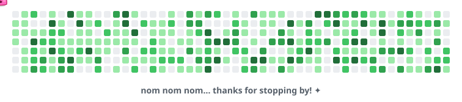

<p align="center">
  
</p>

<p align="center">
  
  
  <a href="https://github.com/abi-techinnovation"></a>
  
</p>

<p align="center">
  
</p>

<p align="center">
  
</p>

## 🧑‍💻 About me

```python
class AbiShimoji:
    company   = "ABI Inc."            # 🏢 https://github.com/abi-techinnovation
    location  = "Japan 🇯🇵"
    speaks    = ["Python", "Lua", "HTML"]
    lives_in  = ["Windows", "WSL", "Obsidian"]
    currently = [
        "watching CVE feeds 🔍",
        "making tech-talk slides 🎤",
        "tweaking dotfiles (forever) 🔧",
    ]

    def say_hi(self):
        print("Thanks for stopping by! Feel free to say hi 👋")
```

## 🧰 Toolbox

<table>
  <tr>
    <td align="center"><b>Languages</b></td>
    <td></td>
  </tr>
  <tr>
    <td align="center"><b>Environment</b></td>
    <td></td>
  </tr>
</table>

## 🔭 What I'm tinkering with

| | Project | What it does |
|:-:|---|---|
| 🔍 | **cve-watcher** | Python で CVE の新着を見張る |
| 🎤 | **tech-talk-slides** | 社内外の技術発表のスライド |
| 🪟 | **dotfiles-windows** | Windows の環境設定（Lua 多め） |
| 🐧 | **dotfiles-wsl** | WSL の環境設定 |
| 🗂️ | **obsidian** | 知識メモの置き場 |

## 🔥 Streak

<p align="center">
  <picture>
    <source media="(prefers-color-scheme: dark)" srcset="https://streak-stats.demolab.com?user=abi-shimoji&theme=tokyonight&hide_border=true&background=0D1117&ring=FF6AC1&fire=FF6AC1&currStreakLabel=FF6AC1" />
    
  </picture>
</p>

<details>
  <summary>🥚 <b>Don't click this</b></summary>
  <br />
  <p align="center">
    You found the secret! 🎉 Here's a cookie: 🍪<br />
    <sub>(It's virtual, so zero calories.)</sub>
  </p>
</details>

<p align="center">
  
</p>
